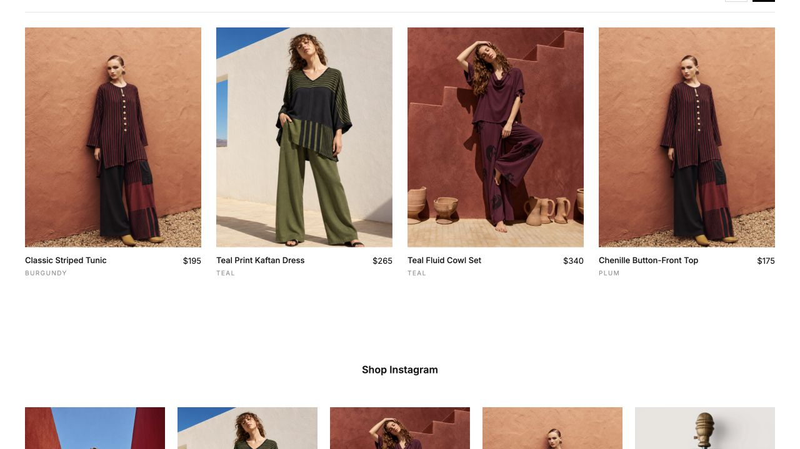

# DAIRI Store Product Carousel

## Design Reference

Live storefront: https://fashion-saas-web-app-ui.vercel.app/store

## Intent

Replace the oversized editorial panel on the DAIRI home page with a minimal, browsable product listing. Keep the surrounding storefront, header, footer, and overall visual language unchanged.

## Layout

- Compact section header with the `DAIRI EDIT` eyebrow and `Selected for the season` title.
- A `Shop all` link routes to `/store/shop`.
- Product cards sit in one horizontal rail rather than a multi-row grid.
- Each card uses a 4:5 product image, product name, color, and price. Avoid extra card borders, category badges, and floating plus controls.
- Show four cards at desktop widths, with a partial next card as a cue to continue scrolling. On narrow screens, show a larger partial card and allow touch scrolling.
- Use restrained spacing, a fine divider below the section heading, and the existing neutral palette.

## Interaction

- Desktop arrow buttons scroll the rail left or right by roughly three-quarters of its visible width.
- The rail supports horizontal swipe/trackpad scrolling and scroll snapping.
- Product cards open their matching product detail route: `/store/products/:id`.
- `Shop all` opens the complete storefront catalog.

## Implementation

- Main component: `src/app/pages/store/StoreFront.tsx`
- Section anchor remains `#journal` to avoid breaking existing navigation.
- The carousel is populated from the existing `storeProducts` data.
- Existing `store-card` motion styles are reused; no new carousel dependency is required.

## Verification

- `pnpm run build` completes successfully.
- Desktop arrow navigation was checked in the local preview.
- Production deployment is live at the storefront URL above.
